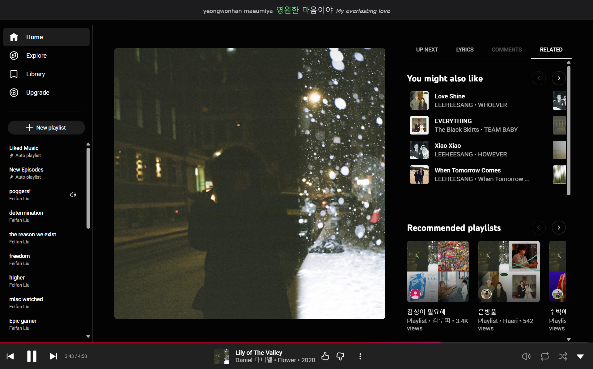
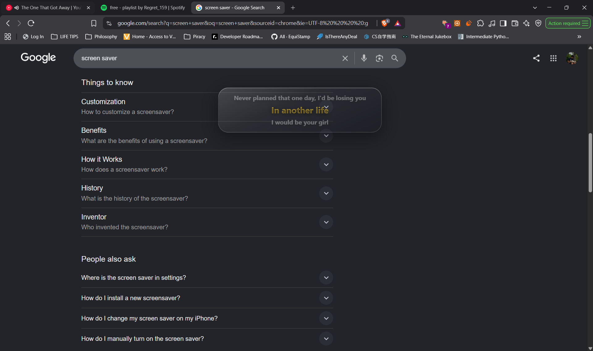
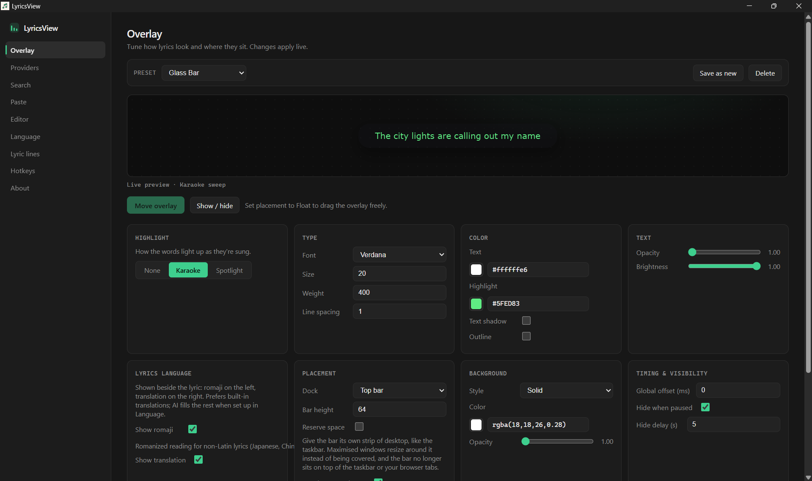
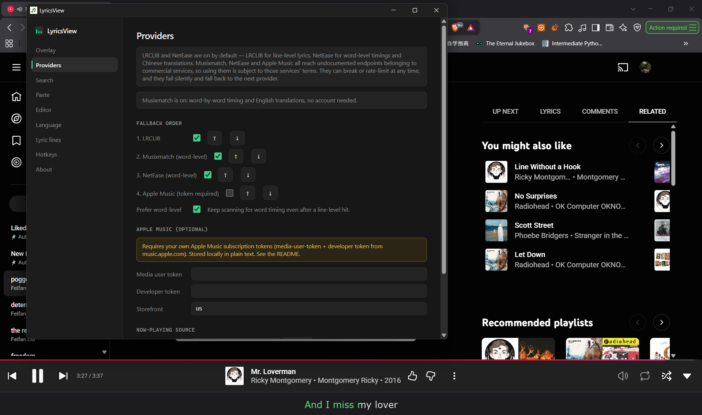
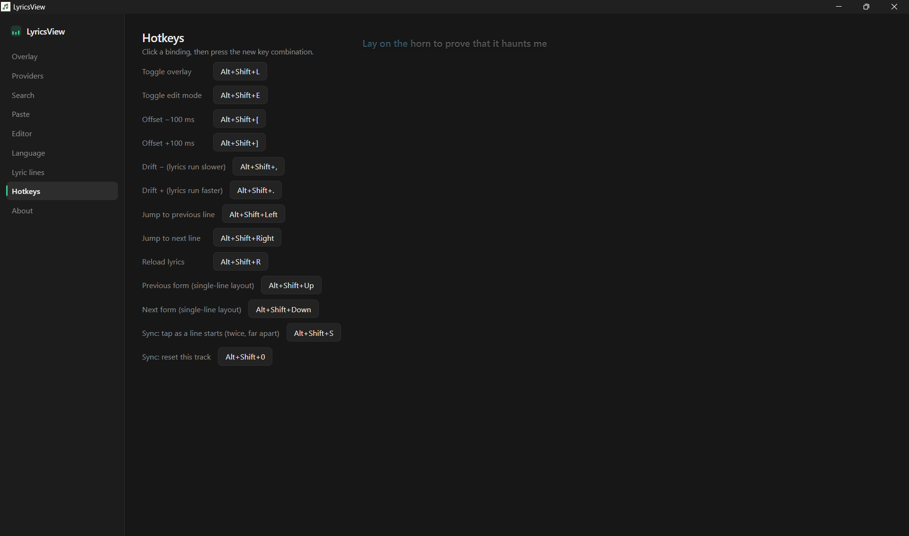

<div align="center">

# LyricsView — User Guide

**Karaoke lyrics for whatever is already playing on Windows.**
No account, no plugin, no telemetry.

</div>



<div align="center">
<i>Docked at the top with its own reserved strip — the browser lays out below it, not behind it.<br>Romaji left, lyric centre, translation right.</i>
</div>

<div align="center">

| | | |
|:--|:--|:--|
| [**Install**](#install) | [**First run**](#first-run) | [**Placement**](#placement) |
| [**Presets**](#presets) | [**Appearance**](#appearance) | [**Romaji & translation**](#romaji--translation) |
| [**Fixing the timing**](#fixing-the-timing) | [**Wrong lyrics**](#wrong-lyrics) | [**Hotkeys**](#hotkeys) |
| [**Troubleshooting**](#troubleshooting) | [**FAQ**](#faq) | [Source →](README.md) |

</div>

---

## Install

Grab `LyricsView_x.y.z_x64-setup.exe` from the
[latest release](https://github.com/feifanl/lyricsview/releases) and run it.

<details>
<summary><b>Building from source instead</b></summary>

<br>

Requires **Node 18+**, **Rust (stable, MSVC)**, and the Windows C++ build tools.

```bash
npm install
npm run tauri dev
```

`npm run tauri build` produces the installer. The Japanese dictionary is copied in
automatically — no manual step.

</details>

> [!NOTE]
> **Windows only.** The overlay reads Windows' own media session (SMTC), which is what
> lets it work with any player without a plugin.

---

## First run

Play something. Spotify, YouTube Music in a browser, Apple Music for Windows,
foobar2000 v2+ — anything that publishes a media session.

The bar appears at the top of your screen and starts following along, sweeping across
each word as it's sung.

| You see | It means |
|:--|:--|
| Lyrics, moving with the song | Working. |
| **waiting for a player…** | Nothing playing yet. Fades on its own. |
| **searching lyrics…** | Fetching. Only shown if it takes a moment. |
| **♪ no lyrics found** | No provider had this track. See [Wrong lyrics](#wrong-lyrics). |
| Nothing at all | Overlay hidden — press <kbd>Alt</kbd>+<kbd>Shift</kbd>+<kbd>L</kbd>. |

Settings live in the tray icon. <kbd>Alt</kbd>+<kbd>Shift</kbd>+<kbd>L</kbd> shows and
hides the overlay at any time.

> [!TIP]
> Outside edit mode the overlay is **click-through** — clicks pass to whatever is
> underneath. It never steals focus from a game or a browser.

---

## Placement

**Settings → Overlay → Placement**

### Dock

| Mode | Behaviour |
|:--|:--|
| **Top bar** | Full-width strip along the top edge. |
| **Bottom bar** | Same, along the bottom. |
| **Float** | Free-floating box you place yourself. |

### Reserve space

Docked only — and the difference between a bar that's in the way and one that isn't.

| | Result |
|:--|:--|
| **Off** | The bar sits on top. Maximise a window and the bar covers it — your browser tabs, usually. |
| **On** | The bar gets its own strip of desktop, like the taskbar. Maximised windows end where the bar begins, so nothing is ever covered. |

Windows slides the strip clear of the taskbar for you, so the bar never sits on top of
it.

> [!NOTE]
> **The strip is only held while a song with lyrics is playing.** Claiming it resizes every
> maximised window on your desktop, which isn't worth doing for a bar showing nothing.
> Pause for about twenty seconds and your windows reclaim the space; press play and they
> give it back. A track with no lyrics gives the space back as soon as its
> **♪ no lyrics found** note fades. The bar itself doesn't move either way — only whether
> windows lay out around it.

### Strip fill

Painted behind the whole bar, not just the lyric box.

- **Match system theme** — follows Windows light/dark, and moves with it when you
  switch. On by default.
- Untick it to pick a fixed colour.
- **Strip opacity** — `0` is fully transparent so your wallpaper shows through, `1` is
  solid.

### Moving a floating overlay

Set Dock to **Float**, then press <kbd>Alt</kbd>+<kbd>Shift</kbd>+<kbd>E</kbd> or click
**Move overlay**. Drag from anywhere in the box, drag the edges and corners to resize,
click the green check when done.

Position and size save as you drag — per preset, per monitor.

---

## Presets

A preset is a complete look **plus** its placement. Three ship with the app:

| | Placement | Shape |
|:--|:--|:--|
| **Glass Bar** | Docked top, reserves space | One line, full width. The default. |
| **Karaoke** | Float | Large box with the previous and next lines either side of the current one. |
| **Gaming** | Float | Small, dim, no background box. Made to sit in a corner. |



<div align="center">
<i>The Karaoke preset: the sung line highlighted, the lines either side dimmed.</i>
</div>

Switch with the **Preset** dropdown. **Save as new** captures your current settings
under a new name; **Delete** removes the selected one.

Each preset keeps its own position, so switching away and back puts everything where you
left it.

---

## Appearance

**Settings → Overlay.** The preview updates as you type, and so does the real overlay.



### Highlight

| Mode | Effect |
|:--|:--|
| **Karaoke** | Sweeps a fill across each word as it's sung. Default. |
| **Spotlight** | Brightens only the word being sung. |
| **None** | Flat line, no animation. |

### The rest

| Card | Controls |
|:--|:--|
| **Type** | Font, size, weight, line spacing. Only fonts actually installed are listed, each drawn in its own typeface. |
| **Color** | **Text** is unsung words, **Highlight** is the sweep. Shadow and outline help over busy backgrounds. |
| **Text** | Opacity and brightness for the text alone, independent of the box behind it. |
| **Background** | The box behind the lyric: **Glass** (blurred), **Solid**, or **None**. |
| **Lines above / below** | How many neighbouring lines to show. `0` keeps it to one line; Karaoke uses `1` and `1`. |

> [!TIP]
> The bar never clips text. If a line doesn't fit at your chosen size, the font shrinks
> to fit — a long line comes out smaller, never cut off.

---

## Romaji & translation

**Settings → Overlay → Lyrics language**

**Show romaji** puts a romanized reading to the left of the lyric — Japanese, Chinese,
Korean, Russian. Entirely offline: no key, no network.

**Show translation** puts a translated line to the right. Both also appear on the
neighbouring lines, dimmed, so you can read ahead. The bar at the top of this page shows
all three at once: `yeongwonhan maeumiya` · 영원한 마음이야 · *My everlasting love*.

### Where translations come from

Bundled translations are preferred; an AI service is only a fallback, and only if you
set one up.

| Source | Languages | Default |
|:--|:--|:--|
| **Musixmatch** | Many, including English. **No account needed.** | Off — turn on in Settings → Providers |
| **NetEase** | Chinese, written for a Chinese-reading audience | On |



> [!IMPORTANT]
> If your target language is English and the only translation available is Chinese, **no
> translated line appears.** That's deliberate — a translation you can't read is worse
> than none. Enabling **Musixmatch** is usually the fix.

<details>
<summary><b>Using your own DeepL / Google / OpenAI key</b></summary>

<br>

**Settings → Language → Translation.** Pick DeepL, Google Cloud Translation, or any
OpenAI-compatible endpoint (base URL and model are configurable), paste your key, set a
target language.

Lines are translated once per track in a single batched request, then cached — replaying
a song costs nothing. AI only ever fills lines that arrived without a translation.

</details>

<details>
<summary><b>Furigana above kanji</b></summary>

<br>

**Settings → Language** can place furigana above Japanese kanji instead of using a
separate romaji column. The first Japanese track after launch takes a few seconds while
the dictionary loads — once per session, not per song.

</details>

---

## Fixing the timing

Two different problems that look similar. The fix differs, so tell them apart first.

| Symptom | Cause | Fix |
|:--|:--|:--|
| Off by the same amount all song | Your player reported its position late | [Nudge the offset](#the-whole-song-is-early-or-late) |
| Starts fine, drifts further out as it goes | Lyrics timed to a **different release** | [Tap twice](#drift-that-grows-through-the-song) |

### The whole song is early or late

<kbd>Alt</kbd>+<kbd>Shift</kbd>+<kbd>[</kbd> and <kbd>Alt</kbd>+<kbd>Shift</kbd>+<kbd>]</kbd>
nudge by ±100 ms. Saved for that track.

Common with Spotify, which doesn't publish a continuous timeline.

### Drift that grows through the song

Fine at the first chorus, several lines out by the end. The lyrics were timed to a
different recording — a remaster, a single edit, a live take. The two run at slightly
different speeds, so the error compounds. **Nudging the offset cannot fix this.**

Instead, tap twice:

1. Press <kbd>Alt</kbd>+<kbd>Shift</kbd>+<kbd>S</kbd> exactly as a line begins.
2. Wait — **at least a minute**, longer is better — and press it again as another line
   begins.

The speed difference is solved from the two taps and applied to the whole track. A toast
in the bar tells you where you are:

| Toast | Meaning |
|:--|:--|
| `sync 1 — offset only, tap further apart for drift` | Taps too close to separate a constant offset from a speed difference. Keep playing, tap again later. |
| `drift −3.28% / offset −1128 ms` | Solved. Saved for this track, applied automatically next time. |

<kbd>Alt</kbd>+<kbd>Shift</kbd>+<kbd>0</kbd> clears the correction and starts over.

> [!WARNING]
> Tap on a line you're certain of — a chorus you know cold. A mistimed tap is worse than
> no tap, because everything else is solved against it.

---

## Wrong lyrics

Not drift — the wrong words entirely, or none.

| Try | How |
|:--|:--|
| **Reload** | <kbd>Alt</kbd>+<kbd>Shift</kbd>+<kbd>R</kbd> refetches, bypassing the cache. Can upgrade a line-level result to word-level. Try this first. |
| **Pick another source** | **Settings → Search** — search by title and artist, preview what each provider has, apply the match. Remembered for that track. |
| **Paste your own** | **Settings → Paste** takes `.lrc` text directly. |
| **Time it yourself** | **Settings → Editor** has tap-to-stamp: play, tap as each line begins, export `.lrc`. |

> [!NOTE]
> **The bar goes blank during instrumentals.** That's intentional — the break is marked
> in the lyrics file, and holding the last line there would be wrong.

---

## Hotkeys

Global — they work while a game has focus. All rebindable in **Settings → Hotkeys**:
click a binding, then press the new combination.



| Action | Default |
|:--|:--|
| Show / hide overlay | <kbd>Alt</kbd>+<kbd>Shift</kbd>+<kbd>L</kbd> |
| Edit mode (move & resize) | <kbd>Alt</kbd>+<kbd>Shift</kbd>+<kbd>E</kbd> |
| Offset −100 ms / +100 ms | <kbd>Alt</kbd>+<kbd>Shift</kbd>+<kbd>[</kbd> / <kbd>]</kbd> |
| Drift −0.25% / +0.25% | <kbd>Alt</kbd>+<kbd>Shift</kbd>+<kbd>,</kbd> / <kbd>.</kbd> |
| Previous / next line | <kbd>Alt</kbd>+<kbd>Shift</kbd>+<kbd>←</kbd> / <kbd>→</kbd> |
| Cycle lyric form | <kbd>Alt</kbd>+<kbd>Shift</kbd>+<kbd>↑</kbd> / <kbd>↓</kbd> |
| **Sync: tap as a line starts** | <kbd>Alt</kbd>+<kbd>Shift</kbd>+<kbd>S</kbd> |
| Sync: reset this track | <kbd>Alt</kbd>+<kbd>Shift</kbd>+<kbd>0</kbd> |
| Reload lyrics | <kbd>Alt</kbd>+<kbd>Shift</kbd>+<kbd>R</kbd> |

**Cycle lyric form** matters in single-line layouts (**Settings → Lyric lines**), where
one of romaji / original / translation shows at a time and these switch between them.

**Right-click the overlay** to copy the current line as an image.

---

## Troubleshooting

<details>
<summary><b>Nothing appears at all</b></summary>

<br>

Check something is playing, and that the overlay isn't hidden —
<kbd>Alt</kbd>+<kbd>Shift</kbd>+<kbd>L</kbd>.

The overlay **cannot appear over exclusive-fullscreen games.** Switch the game to
borderless windowed. That's a Windows compositing limit, not something the app can work
around.

</details>

<details>
<summary><b>The bar covers my browser tabs</b></summary>

<br>

Turn on **Reserve space** — Settings → Overlay → Placement. See
[Reserve space](#reserve-space).

</details>

<details>
<summary><b>Lyrics keep running after I pause</b></summary>

<br>

Some players report position erratically. The clock ignores a stale report for a few
seconds after a pause, which covers most cases. If one track is persistently wrong,
<kbd>Alt</kbd>+<kbd>Shift</kbd>+<kbd>R</kbd> refetches it.

</details>

<details>
<summary><b>No translated line</b></summary>

<br>

Check **Show translation** is on, then confirm a source can supply your language.
Musixmatch is the usual answer for English and ships disabled — see
[Where translations come from](#where-translations-come-from).

</details>

<details>
<summary><b>"no romaji found"</b></summary>

<br>

The line's script should have romanized but didn't. Japanese needs its dictionary, which
loads on the first Japanese track after launch. The note shows on a couple of lines and
then stops rather than repeating all song.

</details>

<details>
<summary><b>Settings look reset after an update</b></summary>

<br>

They aren't. New settings arrive with their defaults, while anything you changed is kept
as you set it — including preset font sizes. That's why a changed default may not reach
a preset you've already edited.

</details>

<details>
<summary><b>Starting over</b></summary>

<br>

**Settings → About → Clear cache** drops cached lyrics.
Deleting `%APPDATA%\com.lyricsview.app` resets everything, settings included.

</details>

---

## FAQ

**Does it need Spotify Premium, or an account anywhere?**
No. It reads what Windows already reports about the current track, and fetches lyrics
from public sources. No sign-in anywhere.

**Does it work offline?**
Once a track is cached, yes. Lyrics are stored locally on first fetch.

**Does it send my listening history anywhere?**
No telemetry, no account, no auto-update. Track title and artist go to whichever lyrics
provider you have enabled, because that's how a lyric gets found.

**Can I use it with a game?**
Yes, in borderless-windowed mode. The overlay is click-through, so it won't steal focus.
Exclusive fullscreen can't be overlaid — a Windows limit.

**Where are my settings stored?**
`%APPDATA%\com.lyricsview.app` — settings in `settings.json`, cached lyrics under
`lyrics/`.

---

### Contact

For any inquiries or requests for new features/bug fixes, please email feifan.liu@utexas.edu.

---

<div align="center">

[Source & project details →](README.md) · [MIT licensed](LICENSE)

</div>
