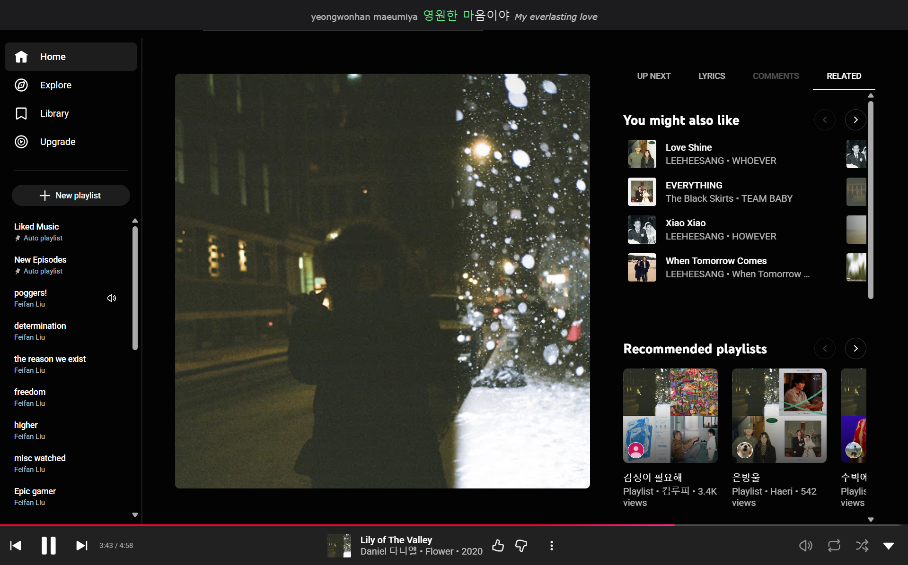
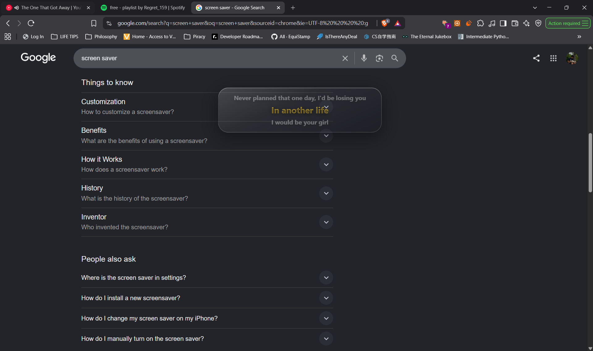
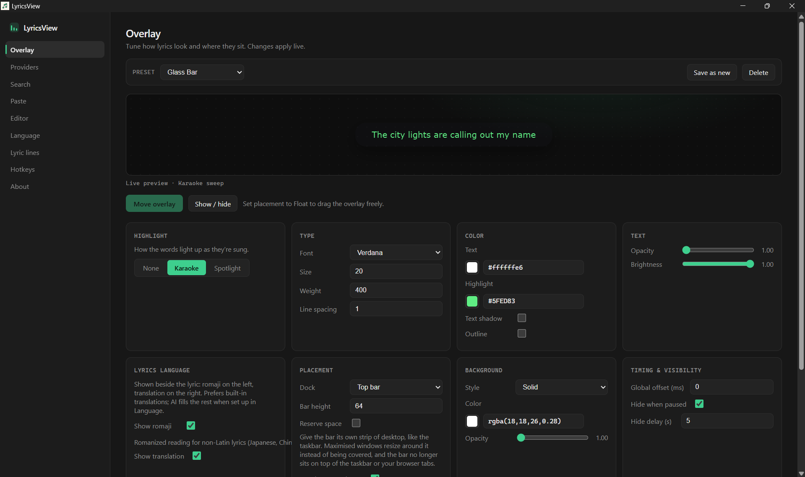
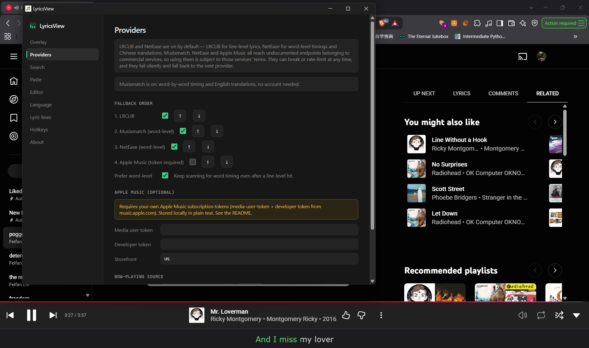
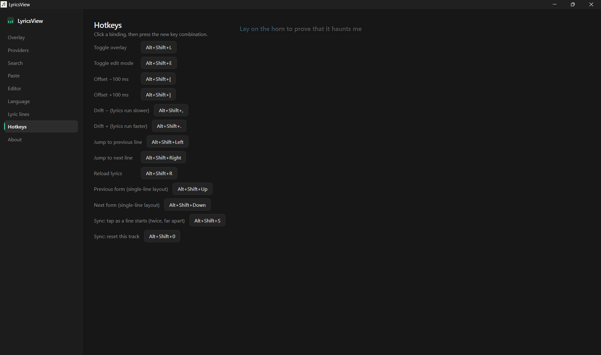

<div align="center">

# LyricsView

**A live-lyrics overlay for Windows.**
Word-by-word synced lyrics -- no plugin, no account, no telemetry.

[](#)
[](#)
[](LICENSE)

### **[📖 User Guide](GUIDE.md)** · [Features](#features) · [Setup](#setup) · [Providers](#lyrics-providers) · [Legal](#legal)

</div>



<div align="center">
<i>The overlay auto-detects any SMTC-compatible player -- Spotify, YouTube Music in a browser, Apple Music for Windows, foobar2000 v2+.<br>In the above screenshot, the overlay has its own reserved space on the display, so lyrics sit without covering anything important.<br>Romaji left, original lyric center, translation right.</i>
</div>

> [!NOTE]
> Lyrics are fetched live per track and cached locally on your machine -- never bundled,
> never redistributed. **This project ships no lyrics data of any kind.**

---

## Screenshots

<table>
<tr>
<td width="50%">

**Karaoke preset**
Floats anywhere, click-through, with the previous and next lines dimmed either side of the one being sung.

</td>
<td width="50%">

**Live settings**
The preview and the real overlay both update as you edit settings.

</td>
</tr>
<tr>
<td></td>
<td></td>
</tr>
<tr>
<td width="50%">

**Providers**
Reorder the chain of lyric providers, toggle any source, add Apple Music tokens if you have them.

</td>
<td width="50%">

**Hotkeys**
Global -- they work even when the setting page is out of focus. Click a binding and press a new combination to change.

</td>
</tr>
<tr>
<td></td>
<td></td>
</tr>
</table>

---

## Features

| | |
|:--|:--|
| **Word-by-word fill** | Driven by an interpolated, drift-corrected playback clock. Line-only lyrics still get smooth per-word fill by interpolation. |
| **Provider fallback** | LRCLIB (line-level) → Musixmatch richsync → NetEase yrc → Apple Music syllable TTML. |
| **Reserves desktop space** | A docked bar can claim its own strip like the taskbar, so maximised windows lay out around it instead of being covered — held only while something is playing. |
| **Two-tap drift fix** | Lyrics timed to a different release drift linearly. Tap twice, a minute apart, and the correction is solved and saved per track. |
| **Offline romanization** | Japanese romaji + furigana, Chinese pinyin, Korean romaja, Russian transliteration. |
| **Translation** | Bundled provider translations first; optionally your own DeepL / Google / OpenAI-compatible key, batched once per track. |
| **Local cache** | Per-track, works fully offline on replay. Preferred-source pick, per-track offset and drift. |
| **Presets** | Glass Bar / Karaoke / Gaming, plus your own. Full live appearance control. |
| **Global hotkeys** | Offset, drift, line jump, reload, toggle overlay and edit mode. |
| **Editor** | Tap-to-stamp timing, `.lrc` export, paste/import. Share a line as a PNG card. |

Built with **Tauri 2** (Rust core) and **vanilla TypeScript / Vite** — no UI framework.

---

## Setup

Download `LyricsView_x.y.z_x64-setup.exe` from the
[latest release](https://github.com/feifanl/lyricsview/releases), or build it:

```bash
npm install
```

```bash
npm run tauri dev
```

```bash
npm run tauri build
```

Requires **Node 18+**, **Rust (stable, MSVC)**, and the Windows build tools (Visual
Studio C++ / Build Tools + WebView2, which ships with Windows 11). The kuromoji
dictionary for Japanese is copied into `public/kuromoji-dict` by a `predev`/`prebuild`
script — no manual step.

---

## Lyrics providers

**LRCLIB and NetEase are enabled out of the box.** LRCLIB is an open, public,
no-authentication API built to be used exactly this way. NetEase supplies the word-level
timings and bundled translations LRCLIB doesn't carry.

| Provider | Default | Notes |
|:--|:--:|:--|
| **LRCLIB** | **on** | Open public API, line-level |
| **NetEase** | **on** | Undocumented endpoint; word-level yrc, bundled translations, strong CJK |
| **Musixmatch** | off | Undocumented endpoint; word-level richsync **and translations**; no account needed |
| **Apple Music** | off | Requires your own subscription tokens |

Musixmatch needs no account — it's off because it's the most exposed of the undocumented
endpoints, not because it's hard to use. Musixmatch, NetEase and Apple Music all reach
undocumented endpoints belonging to commercial services, and using them is subject to
those services' terms.

Change any of them in **Settings → Providers**.

<details>
<summary><b>Apple Music setup (optional, off by default)</b></summary>

<br>

Apple Music syllable lyrics require **your own Apple Music subscription tokens** — no
token is shipped.

1. Sign in at <https://music.apple.com> in a browser.
2. Open DevTools → Network, play a song, inspect a request to `amp-api.music.apple.com`:
   - **`Authorization: Bearer …`** → your *developer token*
   - **`Music-User-Token: …`** → your *media-user-token*
3. In **Settings → Providers → Apple Music**, paste both and set your storefront (e.g.
   `us`), then enable the provider.

Tokens are stored locally in plain text and are only ever sent to Apple's own API.

</details>

<details>
<summary><b>Translation without a provider that carries one</b></summary>

<br>

**Settings → Language → Translation** takes a DeepL, Google Cloud Translation, or
OpenAI-compatible key (configurable base URL + model). Lines are translated once per
track in a single batched request and cached.

Without a key, translations come from whichever provider supplies them. **Musixmatch**
carries many languages including English and needs no account, but ships disabled.
**NetEase** carries Chinese `tlyric`, only shown when your target language is Chinese —
a Chinese translation isn't shown to someone reading English.

With neither enabled and no key, the translated line stays blank, and the overlay says
so once rather than leaving you guessing.

</details>

---

## Known limitations

- **Windows only.**
- The overlay appears over borderless-windowed games but **cannot appear over
  exclusive-fullscreen applications** — a Windows compositing limitation, not a bug.
- Requires **foobar2000 v2+** (older versions don't expose SMTC).
- **Musixmatch / NetEase / Apple Music are unofficial** endpoints: they can break,
  rate-limit, or return a captcha at any time. They fail silently and fall back to the
  next provider, and each can be disabled.
- Some players (Spotify) don't emit continuous timeline events; the app polls every
  second to compensate. Where a player never republishes its position, the clock
  free-runs from a single anchor, so a stale anchor offsets the whole song — per-track
  offset correction exists for this.
- A lyrics file may be timed to a different release than the one you're playing, causing
  drift that grows through the song. See
  [Fixing the timing](GUIDE.md#fixing-the-timing).

---

## Legal

This is an unofficial, independent project. It is **not affiliated with, endorsed by, or
connected to** Spotify, Apple, Musixmatch, NetEase, LRCLIB, or any other service it can
talk to. All trademarks belong to their respective owners.

The project contains **no lyrics data**. Lyrics are fetched at runtime from whichever
provider you enable, and cached locally on your own machine as private data. Nothing is
bundled, uploaded, or redistributed. There is no telemetry, no account, and no
auto-update.

You are responsible for your own use of the third-party services this client can reach,
including any credentials you supply and the terms those services impose. LRCLIB and
NetEase are enabled by default; the rest are opt-in for that reason.

---

<div align="center">

**[📖 Read the User Guide](GUIDE.md)** · MIT licensed — see [LICENSE](LICENSE)

</div>
